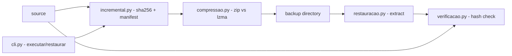

# lab-backup-recuperacao

**English** · [Português (Brasil)](README.md)

[](#) [-4CAF50?style=flat-square)](#) [](#) [](LICENSE)

## What it is

**backuplab**: local backup with a full cycle — SHA-256 hash-based incremental, compression (zip/lzma), GFS retention policy, restore, and byte-for-byte verification. A pure-Python CLI (zero runtime dependencies) that also works as an educational backup lab.

## Status

Working and tested: **48 tests** passing (`pytest tests/`). CLI with two commands: `executar` (run) and `restaurar` (restore).

## Features

- **Incremental backup** (`incremental.py`): scans the source, computes the SHA-256 of every file, writes a **manifest**, and copies only what changed (new or different hash).
- **Compression** (`compressao.py`): tries `zipfile` and `lzma`, keeps the smaller one (`melhor()`), reports the ratio.
- **GFS policy** (`politica.py`): classifies each backup against retention windows; `expirar()` lists the ones past their window.
- **Restore** (`restauracao.py`): `restaurar()` unpacks a backup into a destination; `restaurar_e_verificar()` restores and compares hashes against the source.
- **Byte-for-byte verification** (`verificacao.py`): `catalogo()` + `comparar()` return identical/different/missing; `verificar_restauracao()` is `True` only when everything matches.
- **CLI** (`backuplab`): `executar` and `restaurar`, with `--metodo zip|lzma`, `--verificar` and `--origem` (verification reference).

## Architecture

A `backuplab` package (under `src/`) with one module per cycle stage; `cli.py` orchestrates the subcommands.



## Stack

- Python ≥ 3.10 — **runtime dependency: zero** (zipfile, lzma, hashlib and shutil are stdlib)
- pytest ≥ 7.4 (dev, optional)
- GitHub Actions (`ci.yml`) runs the tests on CI

## Repository layout

```
lab-backup-recuperacao/
├── pyproject.toml · requirements.txt · LICENSE
├── src/backuplab/
│   ├── cli.py          # parser and executar/restaurar subcommands
│   ├── incremental.py  # scan, sha256, manifest (Estado/Manifesto)
│   ├── compressao.py   # zip vs lzma, melhor(), ratio
│   ├── politica.py     # GFS: classify and expire
│   ├── restauracao.py  # restore + restore-and-verify
│   ├── verificacao.py  # hash catalog + comparison
│   └── __main__.py     # python -m backuplab
├── tests/              # 48 tests (cli, compressao, incremental, restauracao, verificacao)
├── dados/              # generated sample data (100 groups)
├── docs/               # retention policy, restore test docs
├── exemplos/           # sample backup report
├── tools/              # sample-data generators
└── .github/workflows/ci.yml
```

## Prerequisites and installation

Python ≥ 3.10. No runtime dependencies.

```bash
pip install -e .          # installs the `backuplab` CLI
pip install -e ".[dev]"   # optional: pytest
```

## How to run

```bash
# incremental backup (zip by default; lzma compresses more)
backuplab executar --origen meus-dados --destino backups/

# restore and verify against the source
backuplab restaurar --backup backups/ --destino restauracao/ --origem meus-dados --verificar

# or without installing
python -m backuplab executar --origem meus-dados --destino backups/
```

Real `executar` output (verified by the agent):

```
arquivos na origem: 1
novos: 1  modificados: 0
copiados: 1  taxa: 1933.33%
```

## Tests and quality

Real command (verified by the agent):

```bash
python -m pytest tests/
# 48 passed
```

## Technical decisions and trade-offs

- **Zero runtime dependencies**: runs on any Python 3.10+; in exchange, no cloud, encryption or scheduler.
- **SHA-256 per file**: exact incrementals and byte-for-byte verification; in exchange, it re-reads everything each cycle (slower than `mtime`).
- **Double compression attempt**: the smaller archive wins; lzma compresses more but costs CPU.
- **Home-grown GFS** (retention windows): transparent and testable; in exchange, no storage-service integration.

## Known limitations and roadmap

- Local backup only: no upload to S3/B2 and no encryption.
- The GFS expiration is a library function; scheduling it (cron/Task Scheduler) is outside the CLI.
- No volume snapshots — regular files only.

## Development process

An individual project by Kelvin Oliveira, built with orchestrated AI agents and reviewed by the author. The backup-cycle design and the review are the author's.

## License and author

MIT — Copyright (c) 2026 Kelvin Rebelo de Oliveira.

**Author**: [Kelvin Oliveira](https://github.com/KelvinOliveiraCode) · [Portfolio](https://kelvinoliveiracode.github.io/portfolio/)
