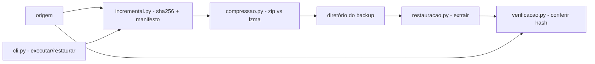

# lab-backup-recuperacao

[English](README.en.md) · **Português (Brasil)**

[](#) [-4CAF50?style=flat-square)](#) [](#) [](LICENSE)

## O que é

**backuplab**: backup local com ciclo completo — incremental por hash SHA-256, compressão (zip/lzma), política de retenção GFS, restauração e conferência byte a byte. CLI em Python puro (zero dependências de execução) e também um laboratório educacional de backup.

## Status

Funcional e testado: **48 testes** passando (`pytest tests/`). CLI com dois comandos: `executar` e `restaurar`.

## Funcionalidades

- **Backup incremental** (`incremental.py`): varre a origem, calcula SHA-256 de cada arquivo, grava um **manifesto** e copia só o que mudou (novo ou hash diferente).
- **Compressão** (`compressao.py`): tenta `zipfile` e `lzma`, guarda o menor (`melhor()`) e relata a taxa.
- **Política GFS** (`politica.py`): classifica cada backup (por janela de retenção) e `expirar()` aponta os backups expirados.
- **Restauração** (`restauracao.py`): `restaurar()` extrai o backup para um destino; `restaurar_e_verificar()` restaura e compara os hashes contra a origem.
- **Verificação byte a byte** (`verificacao.py`): `catalogo()` + `comparar()` devolvem iguais/diferentes/faltando; `verificar_restauracao()` só é `True` quando tudo confere.
- **CLI** (`backuplab`): `executar` e `restaurar`, com `--metodo zip|lzma`, `--verificar` e `--origem` (referência da conferência).

## Arquitetura

Pacote `backuplab` (em `src/`) com um módulo por etapa do ciclo; `cli.py` orquestra os subcomandos.



## Stack

- Python ≥ 3.10 — **dependência de execução: zero** (zipfile, lzma, hashlib e shutil são stdlib)
- pytest ≥ 7.4 (dev, opcional)
- GitHub Actions (`ci.yml`) roda os testes no CI

## Estrutura do repositório

```
lab-backup-recuperacao/
├── pyproject.toml · requirements.txt · LICENSE
├── src/backuplab/
│   ├── cli.py          # parser e subcomandos executar/restaurar
│   ├── incremental.py  # varredura, sha256, manifesto (Estado/Manifesto)
│   ├── compressao.py   # zip vs lzma, melhor(), taxa
│   ├── politica.py     # GFS: classificar e expirar
│   ├── restauracao.py  # restaurar + restaurar_e_verificar
│   ├── verificacao.py  # catálogo de hashes + comparação
│   └── __main__.py     # python -m backuplab
├── tests/              # 48 testes (cli, compressao, incremental, restauracao, verificacao)
├── dados/              # arquivos de exemplo (gerados, 100 grupos)
├── docs/               # politica-de-retencao.md, teste-de-restauracao.md
├── exemplos/           # relatorio-backup.md
├── tools/              # geradores de dados de exemplo
└── .github/workflows/ci.yml
```

## Pré-requisitos e instalação

Python ≥ 3.10. Sem dependências de execução.

```bash
pip install -e .          # instala o CLI `backuplab`
pip install -e ".[dev]"   # opcional: pytest
```

## Como executar

```bash
# backup incremental (default zip; lzma comprime mais)
backuplab executar --origem meus-dados --destino backups/

# restaurar e conferir contra a origem
backuplab restaurar --backup backups/ --destino restauracao/ --origem meus-dados --verificar

# ou sem instalar
python -m backuplab executar --origem meus-dados --destino backups/
```

Saída real de um `executar` (verificada pelo agente):

```
arquivos na origem: 1
novos: 1  modificados: 0
copiados: 1  taxa: 1933.33%
```

## Testes e qualidade

Comando real (verificado pelo agente):

```bash
python -m pytest tests/
# 48 passed
```

## Decisões técnicas e trade-offs

- **Zero dependências de execução**: roda em qualquer Python 3.10+; em troca, sem nuvem, criptografia ou agendador.
- **SHA-256 por arquivo**: incremental exato e verificação byte a byte; em troca, relê tudo a cada ciclo (mais lento que `mtime`).
- **Dupla tentativa de compressão**: o menor arquivo vence; lzma comprime mais, mas custa CPU.
- **GFS próprio** (janela de retenção): transparente e testável; em troca, sem integração com serviços de armazenamento.

## Limitações conhecidas e roadmap

- Backup é local: sem upload para S3/B2 e sem criptografia.
- A expiração GFS é uma função da biblioteca; agendar (cron/Task Scheduler) fica fora do CLI.
- Sem snapshot de volume — só arquivos regulares da origem.

## Processo de desenvolvimento

Projeto individual de Kelvin Oliveira, construído com agentes de IA orquestrados e revisado pelo autor. O design do ciclo de backup e a revisão são do autor.

## Licença e autor

MIT — Copyright (c) 2026 Kelvin Rebelo de Oliveira.

**Autor**: [Kelvin Oliveira](https://github.com/KelvinOliveiraCode) · [Portfólio](https://kelvinoliveiracode.github.io/portfolio/)
